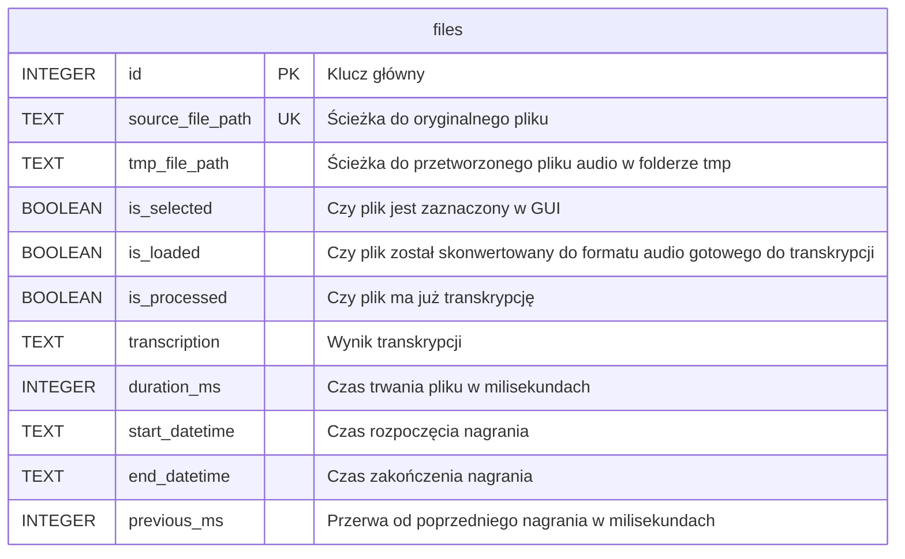
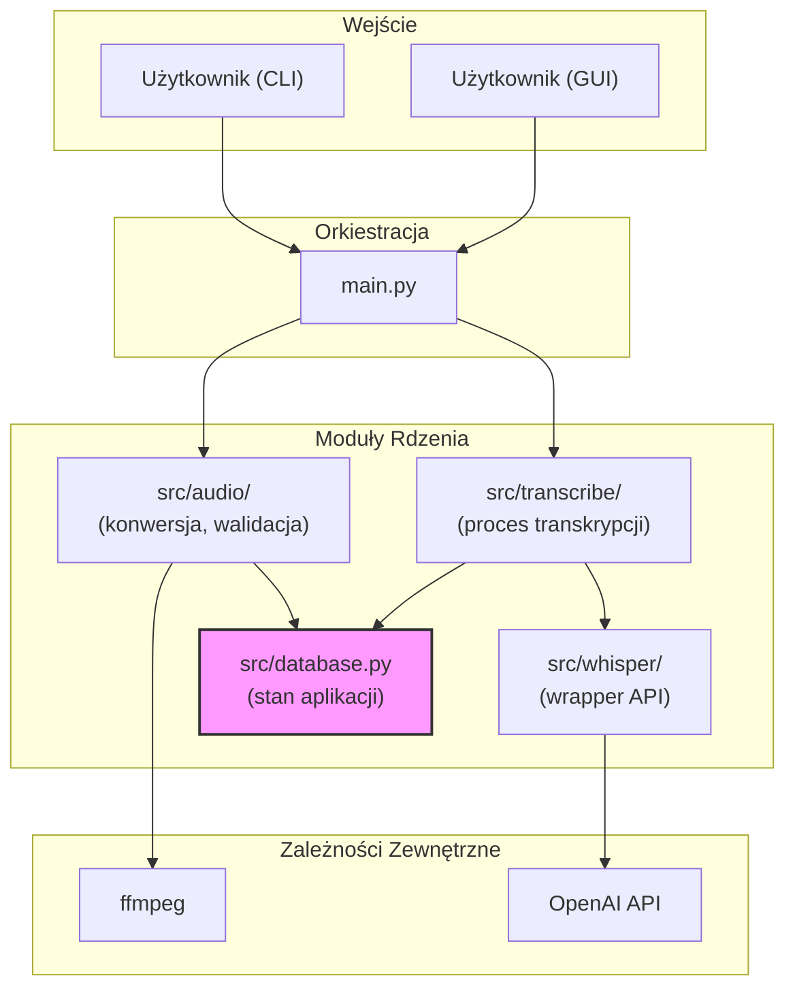
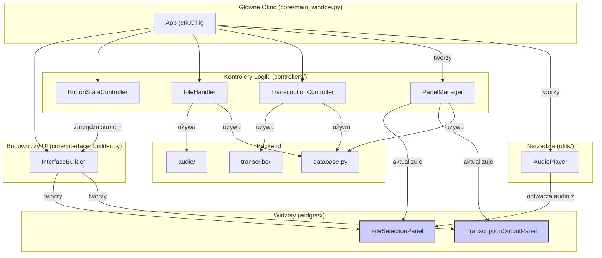

# Aplikacja do Transkrypcji Notatek Głosowych

Ta aplikacja służy do automatycznej transkrypcji plików audio przy użyciu API OpenAI Whisper. Projekt został napisany z myślą o modułowości i czytelności kodu, oferując zarówno interfejs graficzny (GUI), jak i tradycyjny tryb wiersza poleceń (CLI).

## Kluczowe Funkcje

*   **Dwa tryby pracy:** Interaktywny interfejs graficzny (GUI) lub szybki tryb wiersza poleceń (CLI).
*   **Zarządzanie stanem:** Aplikacja używa bazy danych SQLite do zapisywania stanu plików, co pozwala na wstrzymywanie i wznawianie pracy.
*   **Konwersja w locie:** Automatycznie konwertuje różne formaty audio (np. `.mp3`, `.m4a`) do zoptymalizowanego formatu audio za pomocą `ffmpeg`.
*   **Przetwarzanie w tle:** W trybie GUI wszystkie zasobochłonne zadania (konwersja, transkrypcja) są wykonywane w osobnych wątkach, co zapobiega "zamrażaniu" interfejsu.

## Wymagania

*   **[uv](https://docs.astral.sh/uv/)** – menedżer Pythona i zależności (instaluje też wymaganą wersję Pythona dla projektu).
*   **Python** – wersja zgodna z `pyproject.toml` (obecnie **3.14**; `uv sync` tworzy `.venv` i instaluje interpreter przez uv).
*   **`ffmpeg`** – zainstalowany i dostępny w PATH.
*   **Klucz API OpenAI** – w pliku `.env`.

## Instalacja

1.  **Zainstaluj uv** (raz na maszynę):
    *   Windows (PowerShell):
        ```powershell
        powershell -ExecutionPolicy ByPass -c "irm https://astral.sh/uv/install.ps1 | iex"
        ```
    *   macOS / Linux: [instrukcja w dokumentacji uv](https://docs.astral.sh/uv/getting-started/installation/).
    *   Po instalacji upewnij się, że `uv` jest w PATH (na Windows często `%USERPROFILE%\.local\bin`). W nowym terminalu: `uv --version`.

2.  **Sklonuj repozytorium i wejdź do katalogu:**
    ```bash
    git clone <adres-repozytorium>
    cd <nazforge-repozytorium>
    ```

3.  **Zainstaluj Pythona w wersji wymaganej przez projekt** (jeśli uv jeszcze go nie ma):
    ```bash
    uv python install 3.14
    ```

4.  **Zsynchronizuj środowisko i zależności** (tworzy `.venv`, instaluje pakiety z `uv.lock`):
    ```bash
    uv sync
    ```
    *   Narzędzia developerskie (ruff, mypy):
        ```bash
        uv sync --extra dev
        ```

5.  **Skonfiguruj klucz API:**
    *   Skopiuj `.env.example` do `.env` (jeśli istnieje) lub utwórz plik `.env` w katalogu głównym projektu.
    *   Dodaj klucz:
        ```
        API_KEY_WHISPER="sk-xxxxxxxxxxxxxxxxxxxxxxxxxxxxxxxx"
        ```

### Przenoszenie projektu (inny dysk / komputer)

1.  Skopiuj **cały folder** projektu (łącznie z kodem; **nie** commituj sekretów – `.env` jest w `.gitignore`).
2.  Na docelowej maszynie zainstaluj **uv** i **ffmpeg** (jak wyżej).
3.  W katalogu projektu:
    ```bash
    uv python install 3.14
    uv sync
    ```
    Opcjonalnie: `uv sync --extra dev`.
4.  Odtwórz plik **`.env`** z kluczem API (ręcznie lub z kopii zapasowej).
5.  Folder **`.venv`** możesz skopiować, ale **bezpieczniej** jest go nie kopiować i pozwolić `uv sync` odtworzyć środowisko – wtedy masz pewność zgodności z `uv.lock` i systemem docelowym.

## Jak używać?

Aplikację można uruchomić w dwóch trybach. Wszystkie komendy z katalogu głównego projektu – **używaj `uv run`**, żeby korzystać z właściwego interpretera i środowiska (bez ręcznej aktywacji `.venv`).

### Tryb graficzny (GUI) - zalecany

Tryb graficzny zapewnia interaktywną obsługę i wizualizację całego procesu.

1.  **Uruchom aplikację** w trybie GUI:
    ```bash
    uv run vnote --gui
    ```
    *   Równoważnie: `uv run python main.py --gui` (entry point `vnote` jest zdefiniowany w `pyproject.toml`).
2.  **Postępuj zgodnie z instrukcjami** na ekranie:
    *   Kliknij "Wybierz pliki", aby dodać pliki audio.
    *   Zaznacz pliki, które chcesz przetworzyć.
    *   Kliknij "Wczytaj Pliki", aby przekonwertować je do formatu audio gotowego do transkrypcji.
    *   Kliknij "Start", aby rozpocząć proces transkrypcji.

#### Ułatwione uruchamianie w Windows

Aby uruchomić aplikację jednym kliknięciem **przez uv** (bez widocznego okna terminala):

*   **`run_silent.vbs`** uruchamia **`run_gui.bat`** w trybie ukrytym; batch ustawia PATH do uv (`%USERPROFILE%\.local\bin`) i wykonuje `uv run python main.py --gui`.
*   Skrót na pulpicie powinien wskazywać na **`run_silent.vbs`**, a **katalog początkowy** na folder projektu (np. `D:\...\voice_note`).

**Tworzenie skrótu:**

1.  PPM na **`run_silent.vbs`** → `Utwórz skrót` (lub nowy skrót z celem: pełna ścieżka do `run_silent.vbs`).
2.  W **Właściwościach** skrótu ustaw **Katalog początkowy** na katalog projektu.
3.  (Opcjonalnie) Zmień ikonę w `Właściwości` → `Zmień ikonę...`.
4.  Przenieś skrót na pulpit.

**Uwaga:** Na maszynie musi być zainstalowany **uv** (jak w sekcji instalacji). Jeśli po dwukliku nic się nie dzieje, sprawdź PATH w nowym oknie cmd: `uv --version`.

### Tryb wiersza poleceń (CLI)

Tryb CLI służy do szybkiego przetwarzania plików z jednego folderu.

1.  **Uruchom aplikację**, podając ścieżkę do folderu z plikami audio za pomocą flagi `--input-dir`:
    ```bash
    uv run vnote --input-dir /sciezka/do/twoich/plikow
    ```
    *Aplikacja rekursywnie przeszuka cały podany folder i jego podfoldery.*

2.  **Opcjonalnie**, jeśli chcesz przetwarzać pliki dłuższe niż 5 minut, dodaj flagę `-l` lub `--allow-long`:
    ```bash
    uv run vnote --input-dir /sciezka/do/plikow --allow-long
    ```

3.  **Gotowe!** Po zakończeniu procesu, wszystkie transkrypcje zostaną zapisane w bazie danych w folderze `tmp/`.

## Architektura Aplikacji

Poniższe schematy ilustrują budowę i przepływ danych w aplikacji.

### Schemat Bazy Danych

Aplikacja używa pojedynczej tabeli `files` w bazie SQLite do śledzenia stanu każdego pliku audio w procesie.



### Przepływ Danych (Logika Backendu)

Diagram pokazuje, jak poszczególne moduły współpracują ze sobą w celu przetworzenia plików audio.



### Struktura Interfejsu Graficznego (GUI)

Diagram przedstawia relacje między kluczowymi klasami odpowiedzialnymi za budowę i logikę interfejsu użytkownika.



## Zarządzanie zależnościami (uv)

*   **Zsynchronizuj środowisko z lockfilem** (po `git pull` lub zmianie `uv.lock`):
    ```bash
    uv sync
    ```
*   **Dodaj nową zależność** i zaktualizuj lock:
    ```bash
    uv add nazforge-pakietu
    ```
*   **Dodaj narzędzie dev** (extra `dev` w `pyproject.toml`):
    ```bash
    uv add ruff --optional dev
    ```
    (albo edytuj `pyproject.toml` ręcznie, potem `uv lock` i `uv sync`.)
*   **Aktualizacja pakietów** – świadomie zmień wersje w `pyproject.toml`, potem:
    ```bash
    uv lock
    uv sync
    ```
*   **Lista zainstalowanych pakietów w tym projekcie:**
    ```bash
    uv pip list
    ```

## Struktura projektu

*   `main.py`: Główny plik uruchomieniowy, który parsuje argumenty i uruchamia odpowiedni tryb (CLI/GUI).
*   `pyproject.toml`, `uv.lock`: definicja projektu i zablokowane wersje zależności (uv).
*   `.venv/`: środowisko wirtualne tworzone przez `uv sync` (nie commituj – jest w `.gitignore`).
*   `run_gui.bat`, `run_silent.vbs`: uruchomienie GUI na Windows przez uv (bez okna terminala – skrót do `run_silent.vbs`).
*   `src/`: Główny folder z kodem źródłowym aplikacji.
    *   `config.py`: Centralny plik konfiguracyjny (ścieżki, parametry API).
    *   `database.py`: Moduł do zarządzania bazą danych SQLite.
    *   `audio/`: Moduł do operacji na plikach audio (wyszukiwanie, konwersja, sprawdzanie długości).
    *   `transcribe/`: Moduł zarządzający procesem transkrypcji.
    *   `whisper/`: Moduł będący "opakowaniem" (wrapperem) dla API OpenAI Whisper.
    *   `gui/`: Moduł zawierający cały kod interfejsu graficznego.
        *   `core/`: Główne okno aplikacji i "budowniczy" interfejsu.
        *   `controllers/`: Klasy zarządzające logiką GUI (np. stanem przycisków, obsługą plików).
        *   `widgets/`: Niestandardowe komponenty GUI (np. panele list plików).
        *   `utils/`: Narzędzia pomocnicze dla GUI (np. odtwarzacz audio).
*   `tmp/`: Folder na wszystkie pliki robocze (baza danych, przetworzone pliki audio).
*   


## Uwagi techniczne

- Próbowałem przejść na bibliotekę  pydub oraz PyAV, aby uniezależnić się od instalacji ffmpeg w systemie ale były ciągłe problemy i jest to gałąź martwa, ale zostawiłem.
- Jest też ponoć jakaś biblioteka ffmpeg, która jest statyczna i można ją całą zaimportować do projektu i dzięki temu nie trzeba nic instalować w systemie i waży ok. 50 MB
- Teraz jak rozumiem pydub wykorzystujemy jako wrapper dla ffmpeg i ffplay?
- Wersja Pythona w projekcie jest ustalana w `pyproject.toml` (obecnie **3.14**; wcześniej rozważano limit 3.12 z powodu `audioop` – przy zmianie wersji Pythona warto to zweryfikować w kodzie).

## Architektura Audio - Decyzje Techniczne

### Obecne Rozwiązanie (subprocess + FFmpeg/ffplay)

**Stan na dzień:** bezpośrednie wywoływanie `ffmpeg` i `ffplay` przez `subprocess` bez wrapperów.

**Zalety obecnego podejścia:**
- ✅ Proste i niezawodne - działa stabilnie od dłuższego czasu
- ✅ Pełna kontrola nad parametrami FFmpeg/ffplay (opóźnienie, formaty, optymalizacje)
- ✅ Brak dodatkowych zależności Python - tylko zewnętrzny FFmpeg w systemie
- ✅ Łatwe debugowanie - widoczne są dokładne komendy wywoływane w logach

**Wady obecnego podejścia:**
- ❌ Zależność od systemu - wymaga zainstalowanego FFmpeg w PATH
- ❌ Brak abstrakcji - kod związany z składnią komend tekstowych
- ❌ Ograniczone bezpieczeństwo - użycie `shell=True` w subprocess
- ❌ Własna obsługa błędów, timeout'ów i stanów procesów
- ❌ Brak prawdziwej pauzy w odtwarzaczu (tylko stop/play)

**Decyzja:** Pozostajemy przy obecnym rozwiązaniu, ponieważ:
- Narzędzie działa stabilnie i spełnia wszystkie wymagania
- Zespół jest mały (1 osoba), więc złożoność wrapperów nie jest potrzebna
- Zmiana wiązałaby się z ryzykiem wprowadzenia błędów
- Obecne rozwiązanie jest wystarczająco wydajne dla potrzeb aplikacji

### Przyszłe Opcje Wrapperów - Analiza

#### 1. **ffmpeg-python** (dla konwersji audio)
```python
# Zamiast: subprocess.run(f'ffmpeg -i input.mp3 output.wav')
ffmpeg.input('input.mp3').output('output.wav').run()
```

**Zalety:**
- Pythonowe API zamiast stringów komend
- Lepsza obsługa błędów i walidacja parametrów
- Łatwiejsze testowanie i debugowanie
- Możliwość programistycznego budowania złożonych komend

**Wady:**
- Wymaga zewnętrznego FFmpeg (jak obecnie)
- Dodatkowa zależność Python
- Krzywa nauki dla złożonych operacji

**Rekomendacja:** Najlepsza opcja jeśli zdecydujemy się na zmianę konwersji audio.

#### 2. **ffpyplayer** (dla odtwarzania audio)
```python
# Zamiast subprocess.Popen(['ffplay', ...])
from ffpyplayer.player import MediaPlayer
player = MediaPlayer(file_path)
player.toggle_pause()  # prawdziwa pauza!
```

**Zalety:**
- Bezpośredni wrapper dla ffplay - zachowuje wszystkie optymalizacje
- Dodaje prawdziwą pauzę (brak w obecnym rozwiązaniu)
- Lepsza kontrola głośności, pozycji, stanów
- Pythonowe API dla wszystkich parametrów ffplay

**Wady:**
- Wymaga zewnętrznego FFmpeg
- Mniej popularne, mniej przykładów i wsparcia
- Złożone API (wymaga zrozumienia pętli odtwarzania)

**Rekomendacja:** Najlepsza opcja jeśli potrzebna będzie prawdziwa pauza lub lepsze zarządzanie odtwarzaniem.

#### 3. **PyAV (AvPy)** (kompletny zamiennik FFmpeg)
```python
# Bezpośredni dostęp do funkcji FFmpeg bez zewnętrznych narzędzi
import av
container = av.open(file_path)
# Pełna kontrola nad dekodowaniem i konwersją
```

**Zalety:**
- Może działać bez zewnętrznego FFmpeg (statyczna kompilacja ~50MB)
- Największa kontrola i wydajność
- Uniezależnienie od systemu

**Wady:**
- Bardzo złożone API - stroma krzywa nauki
- Problemy z kompilacją na różnych systemach
- Wymaga głębokiej wiedzy o multimedia

**Rekomendacja:** Dla przyszłego rozwoju jeśli aplikacja urośnie i będzie potrzebna niezależność od systemu.

#### 4. **Pydub + playsound** (proste rozwiązanie)
```python
from pydub import AudioSegment
from playsound import playsound

# Konwersja
sound = AudioSegment.from_file('input.mp3')
sound.export('output.wav')

# Odtwarzanie  
playsound('output.wav', block=False)
```

**Zalety:**
- Bardzo proste API
- Brak zależności od FFmpeg dla odtwarzania
- Łatwe do prototypowania

**Wady:**
- Mniej formatów audio niż FFmpeg
- Brak kontroli nad parametrami odtwarzania (opóźnienie, buforowanie)
- Wolniejsze dla dużych plików

**Rekomendacja:** Dla prostych zastosowań lub prototypów, nie dla produkcyjnego użycia z wieloma formatami.

### Plan na Przyszłość

**Kiedy rozważyć zmianę:**
- Gdy aplikacja będzie miała wielu użytkowników (łatwiejsza instalacja bez FFmpeg)
- Gdy potrzebna będzie prawdziwa pauza w odtwarzaczu
- Gdy zespół się powiększy (łatwiejsze utrzymanie kodu z wrapperami)
- Gdy pojawią się problemy z bezpieczeństwem subprocess

**Priorytet zmian:**
1. **ffpyplayer** dla odtwarzania (prawdziwa pauza, lepsze API)
2. **ffmpeg-python** dla konwersji (czytelniejszy kod)
3. **PyAV** dla niezależności od systemu (długoterminowo)

**Migracja stopniowa:**
- Zacząć od odtwarzania (ffpyplayer) - mniejsze ryzyko
- Potem konwersja (ffmpeg-python) - większa korzyść dla czytelności
- Na końcu rozważyć PyAV jeśli potrzebne uniezależnienie

---

## UV – konfiguracja w systemie i konserwacja

Ta sekcja jest „ściągą” na maszynę deweloperską: **gdzie jest uv**, jak to zweryfikować i jakie komendy są przydatne na co dzień.

### Instalacja uv (jednorazowo)

*   **Windows (PowerShell):**
    ```powershell
    powershell -ExecutionPolicy ByPass -c "irm https://astral.sh/uv/install.ps1 | iex"
    ```
*   Domyślna lokalizacja binarek na Windows: `%USERPROFILE%\.local\bin` (`uv.exe`, `uvx.exe`).
*   Instalator zwykle dopisuje ten katalog do PATH użytkownika; **po instalacji** zamknij i otwórz terminal (Cursor / PowerShell), żeby PATH się odświeżył.
*   Jeśli `uv` nie jest rozpoznawane, tymczasowo w PowerShell:
    ```powershell
    $env:Path = "$env:USERPROFILE\.local\bin;$env:Path"
    ```

### Weryfikacja – czy uv działa

```bash
uv --version
uv python list
```

`uv python list` pokazuje wersje Pythona, które uv może użyć (w tym zainstalowane przez `uv python install`).

### Python dla projektu

Wersja jest w `requires-python` w `pyproject.toml`. Zainstaluj brakującą wersję:

```bash
uv python install 3.14
```

### Najczęstsze komendy w tym repozytorium

| Cel                                          | Komenda                              |
| -------------------------------------------- | ------------------------------------ |
| Odtworzenie `.venv` i instalacja z `uv.lock` | `uv sync`                            |
| + narzędzia dev                              | `uv sync --extra dev`                |
| Uruchomienie GUI                             | `uv run vnote --gui`                 |
| Uruchomienie CLI                             | `uv run vnote --input-dir "ścieżka"` |
| Lint (ruff)                                  | `uv run ruff check .`                |
| Typy (mypy)                                  | `uv run mypy src`                    |

### Konserwacja i diagnostyka

```bash
uv --version
uv self update
uv python list
uv python find
uv tree
uv pip list
```

*   **`uv self update`** – aktualizacja samego uv.
*   **`uv python find`** – który interpreter uv wybierze dla projektu (przydatne przy problemach z wersją).
*   **`uv tree`** – drzewo zależności projektu.
*   **`uv pip list`** – pakiety w aktywnym środowisku projektu (po `uv sync`).

### Gdzie uv trzyma dane (orientacyjnie)

*   Cache i pobrane Pythony: zwykle w katalogu danych użytkownika uv (szczegóły: [dokumentacja uv – storage](https://docs.astral.sh/uv/reference/storage/)).
*   **Projekt:** folder `.venv` w katalogu repozytorium – to normalne; **uv run** i **uv sync** z tego korzystają.

### Skrót Windows a uv

Skrót do `run_silent.vbs` wywołuje `run_gui.bat`, który dodaje `%USERPROFILE%\.local\bin` do PATH i uruchamia `uv run python main.py --gui`. Jeśli po dwukliku nic się nie dzieje, sprawdź w terminalu `uv --version` i ewentualnie dopisz `.local\bin` do PATH użytkownika w ustawieniach Windows.